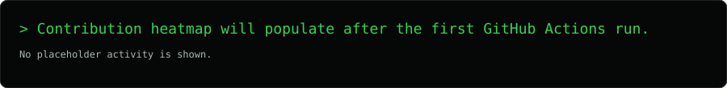
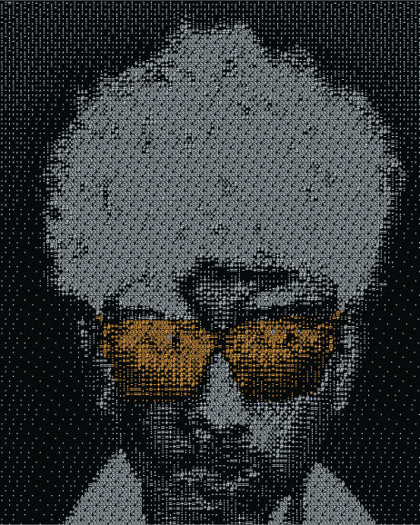
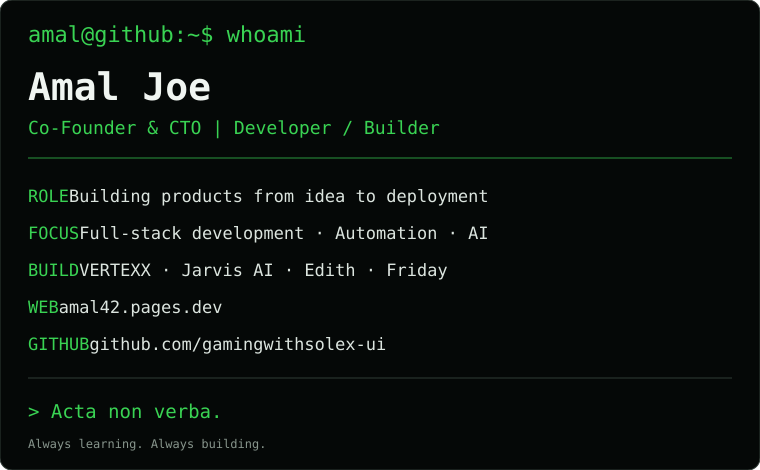

### `amal@github:~$ ./contributions.sh`

### `amal@github:~$ whoami`

<table>
<tr>
<td width="42%" valign="top">

</td>
<td width="58%" valign="top">

</td>
</tr>
</table>

**Building:** VERTEXX · Jarvis AI · Edith · Friday

**Focus:** Full-stack development · Automation · AI

[Portfolio](https://amal42.pages.dev) · [GitHub](https://github.com/gamingwithsolex-ui)

`Acta non verba.`

